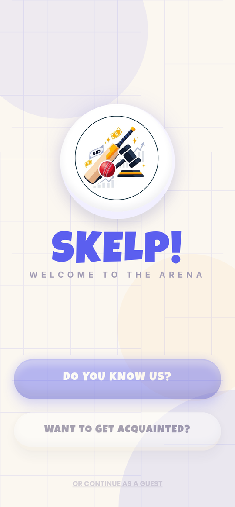
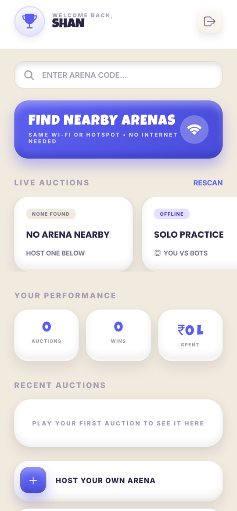

<p align="center">
  
</p>

<h1 align="center">SKELP!</h1>
<p align="center"><b>The IPL-style player auction you play with your friends — fully offline.</b></p>

<p align="center">
  <a href="release/skelp.apk"><b>⬇ Download the Android APK</b></a>
</p>

---

Every cricket fan in India has argued about who they would have bought at the IPL auction.
**Skelp!** lets a group of friends actually do it: everyone gets the same purse, real players come under
the hammer one by one, the clock ticks, and the highest bid takes the player home.

No internet is needed. One phone **hosts** the arena and everyone else on the same Wi-Fi —
or connected to that phone's **mobile hotspot** — joins it directly, phone to phone.

<p align="center">
  
  
  
  
  
</p>

## Features

- **Local multiplayer with no internet** — one phone is the server, up to 10 teams join over Wi-Fi or hotspot.
- **Automatic discovery** — tap *Find nearby arenas* and the app finds the host for you (or type the arena code).
- **Real auction rules** — base prices, IPL-style bid increments, a bid clock that resets on every bid, purse, squad and overseas limits, marquee set first, and an accelerated round for unsold players.
- **137 players** with role, country, base price and rating — 85 of them with a freely-licensed photo, the rest with an initials badge.
- **Bots** — practise solo against AI bidders, or add bots to fill empty seats in a friends' arena.
- **Live room feel** — emoji reactions that pop up on every phone, an alert and buzz when you are outbid, an *Up next* strip and a running *Sold* feed.
- **Scout the pool** — browse and search all players by role before the auction.
- **Results worth sharing** — final table, costliest buy, steal of the auction, and a one-tap share to WhatsApp or anywhere else.
- **Drop-proof** — if a phone loses Wi-Fi it reconnects on its own and gets its team back.
- **Everything stays on the phone** — profile, stats and auction history are stored locally. No accounts, no servers, no ads.

## Install

1. Download [`release/skelp.apk`](release/skelp.apk) on your Android phone (Android 7.0 or newer).
2. Open it and allow *Install unknown apps* when Android asks.
3. Launch **Skelp!**, create a profile (or continue as a guest) and pick an avatar.

## How to play with friends (no internet)

1. **Get everyone on one network.** Either join the same Wi-Fi, or one person turns on their
   **mobile hotspot** and the others connect to it. Mobile data can stay off.
2. **Host:** tap **HOST YOUR OWN ARENA**. The lobby shows an **arena code**.
3. **Everyone else:** tap **FIND NEARBY ARENAS** and tap the arena when it appears under *Live auctions*.
   If it does not show up, type the arena code (or the host address shown in the host's lobby) in the search box.
4. The host picks a mode and the bid clock, optionally adds bots, and taps **START AUCTION**.
5. Bid, jump-bid or pass on each player. When the clock runs out the player is **SOLD** to the highest bidder.
6. When every player has been through, the final table ranks the squads.

> **Tip:** the host's phone runs the auction, so keep Skelp! open on it until the auction ends.
> The app keeps the screen awake for you.

### Auction rules

| Mode | Purse | Players in pool | Max squad | Max overseas |
| --- | --- | --- | --- | --- |
| Quick | ₹50 Cr | 40 | 8 | 3 |
| Classic | ₹90 Cr | 90 | 15 | 6 |
| Mega | ₹120 Cr | 137 | 25 | 8 |

- Bidding opens at the player's **base price** (₹30 L – ₹2 Cr).
- Each bid raises the price by **₹5 L** below ₹1 Cr, **₹10 L** up to ₹2 Cr, **₹20 L** up to ₹5 Cr and **₹25 L** above that. The two smaller buttons place a *jump bid*.
- Every bid resets the clock (10, 15 or 20 seconds). **PASS** takes you out of the current player; if everyone else passes, the hammer falls immediately.
- You cannot bid more than your purse, beyond your squad size, or for an overseas player once your overseas slots are full.
- Players nobody bids on go **unsold** and come back once in an accelerated round at the end.
- The winner is the team with the highest **squad power** — the total rating of its best eleven players.

## How it works

```
        Host phone                              Other phones
┌──────────────────────────┐   TCP :47474   ┌──────────────────────┐
│ auction engine (reducer) │◄──────────────►│ ClientSession        │
│ bid clock + bots         │  JSON lines    │ mirrors host state,  │
│ HostSession (TCP server) │                │ sends bid / pass     │
└──────────────────────────┘                └──────────────────────┘
```

- `game/engine.ts` is a pure reducer holding all the rules. The host applies every action and broadcasts the resulting state, so all phones always agree.
- `game/net/` is the LAN layer: newline-delimited JSON over a plain TCP socket ([react-native-tcp-socket](https://github.com/Rapsssito/react-native-tcp-socket)), heartbeats, automatic reconnect, and discovery by probing the hotspot gateway and then the rest of the local subnet.
- Clients can only bid or pass for themselves; the host validates everything.

## Development

```bash
npm install
```

```bash
npx expo start
```

```bash
npm test
```

`npm test` runs the rules engine tests, complete bot-vs-bot auctions, and an end-to-end LAN test with a host and several clients talking over real TCP sockets. `npm run typecheck` and `npm run lint` are also available.

LAN play needs native sockets, so use a development build or the APK rather than Expo Go. The web build (`npx expo start --web`) supports solo practice only.

### Build the APK

Needs Node 20+, JDK 17, and the Android SDK (platform 36, build-tools 36.0.0, NDK 27.1.12297006) with `ANDROID_HOME` set.

```bash
npm run build:apk
```

The APK is written to `release/skelp.apk`. It is signed with the standard debug key, which is fine for sharing the file directly; publishing on Google Play needs your own signing key.

### Project layout

```
app/                  screens entry (expo-router): splash, welcome, sign in, avatar, about
components/skelp/     dashboard, lobby, live arena, results, shared UI kit
game/                 engine, bots, players, local storage
game/net/             TCP transport, protocol, host & client sessions, discovery
assets/players/       bundled player photos
scripts/              player data and APK build scripts
__tests__/            engine and LAN tests
```

## Credits

- Built by **Pitta Shankumar** — [GitHub](https://github.com/shankumar7)
- Player photos are from [Wikimedia Commons](https://commons.wikimedia.org) and are used under their free licences. Every photo's author and licence is listed in [CREDITS.md](CREDITS.md) and inside the app (*About → Player photos*).
- Player ratings and base prices are game-design values, not official figures.

Skelp! is a fan-made game. It is not affiliated with or endorsed by the IPL, the BCCI or any franchise.
