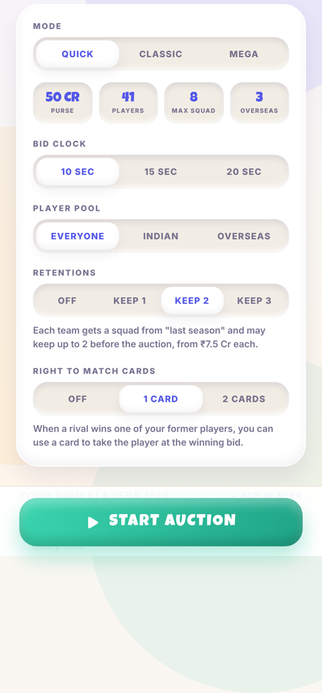
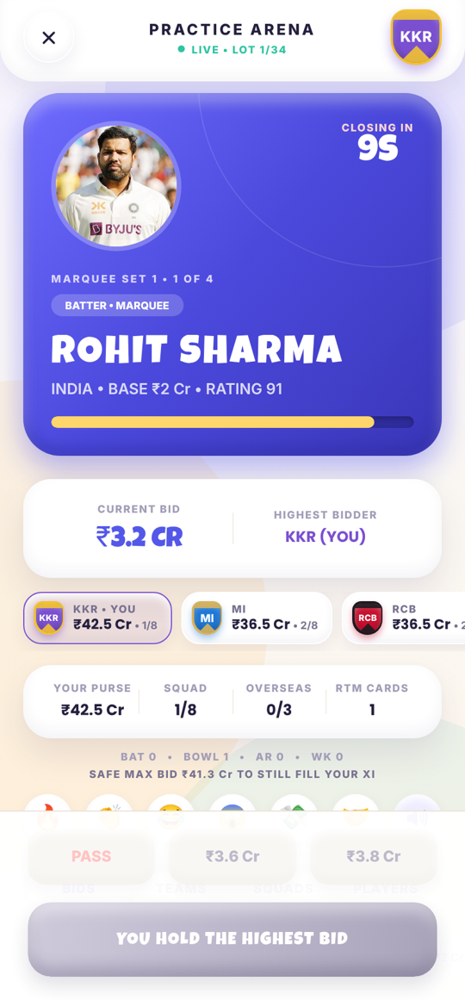
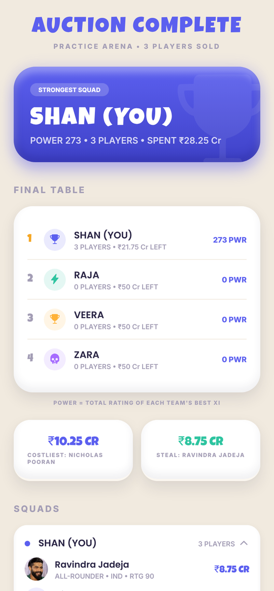
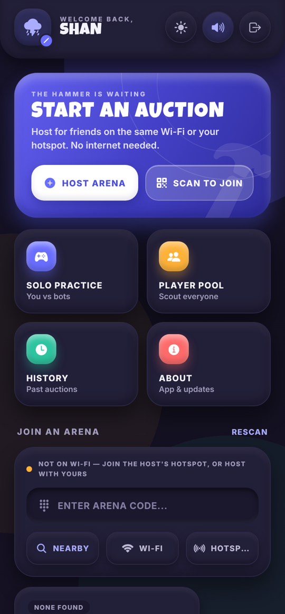

<p align="center">
  
</p>

<h1 align="center">SKELP!</h1>

<p align="center"><b>The IPL-style player auction you play with your friends — offline on Wi-Fi, or online with a code.</b></p>

<p align="center"><sub>Affiliated with <a href="https://classcom.tech">ClassCom</a></sub></p>

<p align="center">
  <a href="https://github.com/shankumar7/skelp/releases/latest/download/skelp.apk"></a>
</p>

<p align="center">
  
  
  
</p>

---

Every cricket fan has argued about who they would have bought at the IPL auction.
**Skelp!** lets a group of friends actually do it. Everyone gets the same purse, real players come
under the hammer one by one, the clock ticks, and the highest bid takes the player home.

**Nearby, no internet needed:** one phone **hosts** the arena, and everyone on the same Wi-Fi — or connected
to that phone's **mobile hotspot** — joins it directly, phone to phone.
**Anywhere, online:** host an online arena and friends join from wherever they are with a six-character code.

<p align="center">
  
  
  
  
  
</p>

## Contents

- [Install](#install)
- [Features](#features)
- [How to play with friends](#how-to-play-with-friends-no-internet)
- [Auction rules](#auction-rules)
- [How it works](#how-it-works)
- [Privacy and security](#privacy-and-security)
- [Development](#development)
- [Credits](#credits)
- [License](#license)

## Install

1. On your Android phone, tap **[Download the APK](https://github.com/shankumar7/skelp/releases/latest/download/skelp.apk)** — the file downloads straight away.
2. Open the downloaded file and allow *Install unknown apps* when Android asks.
3. Launch **Skelp!**, create a free account (or continue as a guest) and pick an avatar.

> **Updating from 1.4 or earlier?** Uninstall the old Skelp! first, then install this one. Since 1.5 the app is signed with its own private key, so Android will not install it over an older copy. You only do this once: from 1.5 on, Skelp! **updates itself** — it tells you when a new version is out, downloads it and opens the installer.

Works on Android 7.0 and newer, on both 64-bit and older 32-bit ARM phones.

## Features

| | |
| --- | --- |
| 📶 **Offline multiplayer** | One phone is the server; up to 10 teams join over Wi-Fi or hotspot. Auctions never need the internet. |
| 🌍 **Online multiplayer** | Friends anywhere join over the internet with a six-character code or an invite message. No account needed. |
| 🔎 **Three ways to join** | Scan the host's **QR code**, tap *Nearby*, or type the arena code. |
| 🏏 **Real auction rules** | Base prices, IPL-style bid increments, a bid clock that resets on every bid, purse, squad and overseas limits, a marquee set and an accelerated round for unsold players. |
| 🃏 **Right to Match and retentions** | Optional: every team gets a squad from "last season", keeps up to three players at fixed prices, and can match the winning bid on a former player with an RTM card. |
| 📺 **Auctioneer mode** | Run the auction on a tablet or spare phone as the big screen while everyone bids from their own phone. |
| 🏟️ **Run a real IPL team** | Everyone picks one of the ten franchises; teams show as CSK, MI, RCB… in their colours. |
| 🗂️ **Sets, like the real auction** | Marquee set first, then Batters Set 1, All-rounders Set 1, Wicket-keepers Set 1, Bowlers Set 1, then each Set 2. The most popular players are in the earlier sets. |
| ⭐ **Shortlist** | Star the players you want; you are alerted the moment one comes up. |
| 💰 **Purses at a glance** | A strip in the arena shows every team's purse and squad, plus your safe maximum bid. |
| 📋 **Players list** | A tab in the arena shows who is on the block, who is still to come, and who was sold to whom for how much. |
| 👥 **137 players, or your own** | Role, country, base price and rating for each; 85 with a freely-licensed photo. Play Indian-only or overseas-only pools, and add up to 20 players of your own. |
| 🤖 **Bots with personality** | Star hunters, bargain hunters, pace lovers… they build balanced squads, jump-bid, retain and use RTM cards. Practise solo or fill empty seats. |
| ↩️ **Host controls** | Pause, undo the latest bid, or end the auction. |
| 🔊 **Sound and haptics** | Bid blips, a ticking last five seconds, the gavel on *Sold*, a buzz when you are outbid. One tap to mute. |
| 🔥 **Live room feel** | Emoji reactions that pop up on every phone, an *Up next* strip and a running *Sold* feed. |
| 🏆 **Results worth sharing** | Final table, costliest buy and steal of the auction — shared as a picture or as text. |
| 🕘 **Auction history** | Every auction you finish is kept on the phone with all its squads. |
| ☁️ **Accounts and backup** | Continue with Google, or sign up with email, to back up your profile and stats. Or just play as a guest. Change your name and avatar any time. |
| 🌙 **Dark mode** | The same soft clay look in light and dark. |
| 📱 **Phones and tablets** | Portrait or landscape; wide screens get a two-column layout. |
| ⬆️ **In-app updates** | Skelp! checks GitHub for a new release, shows what is new and installs it. |
| ⚡ **Instant bids** | Your bid shows the moment you tap; the host confirms it right after. |
| 🔔 **Notifications** | Outbid, shortlisted player up, auction started or finished, a Right to Match waiting — you are told while Skelp! is in the background. |
| 📶 **Connection quality** | Signal bars and the delay to the host, and immediate reconnection when the network changes. |
| 🔁 **Drop-proof** | A phone that loses Wi-Fi or goes to the background reconnects on its own and keeps its team. |

## How to play with friends (no internet)

1. **Get everyone on one network.** Join the same Wi-Fi, or one person turns on their
   **mobile hotspot** and the others connect to it. Mobile data can stay off.
   The dashboard has **HOTSPOT** and **WI-FI** buttons that open the right settings page.
2. **Host:** tap **HOST ARENA** and choose *Play and host* (you own a team too) or *Auctioneer screen* (this device is the big screen). The lobby shows a **QR code** and an **arena code**.
3. **Everyone else:** tap **SCAN TO JOIN** and point the camera at the host's screen.
   Or tap **NEARBY** and pick the arena, or type the arena code.
4. Everyone picks their IPL team. The host picks the mode, bid clock, player pool, retentions and RTM cards, optionally adds bots or players of their own, and taps **START AUCTION**.
5. Bid, jump-bid or pass on each player. When the clock runs out the player is **SOLD** to the highest bidder.
6. When every player has been through, the final table ranks the squads.

> **Tip:** the host's phone runs the auction, so keep Skelp! open on it until the auction ends.
> The app keeps the screen awake for you.

### Playing online

1. **Host:** tap **HOST ARENA**, choose **ANYWHERE • ONLINE**, then *Play and host*. The lobby shows a six-character **arena code**; tap **SHARE INVITE** to send it.
2. **Everyone else:** type the code in the **arena code** box on the dashboard (or scan the QR code).
3. Everyone needs an internet connection, and the host keeps Skelp! open — the host's phone still runs the auction.

## Auction rules

| Mode | Purse | Players in pool | Max squad | Max overseas |
| --- | --- | --- | --- | --- |
| Quick | ₹50 Cr | 40 | 8 | 3 |
| Classic | ₹90 Cr | 90 | 15 | 6 |
| Mega | ₹120 Cr | 137 | 25 | 8 |

- Players come up in **sets**: the marquee set (rating 90+), then each role in sets of about eight, most popular first.
- Bidding opens at the player's **base price** (₹30 L – ₹2 Cr).
- Each bid raises the price by **₹5 L** below ₹1 Cr, **₹10 L** up to ₹2 Cr, **₹20 L** up to ₹5 Cr and **₹25 L** above that. The two smaller buttons place a *jump bid*.
- Every bid resets the clock (10, 15 or 20 seconds). **PASS** takes you out of the current player; if everyone else passes, the hammer falls immediately.
- You cannot bid more than your purse, beyond your squad size, or for an overseas player once your overseas slots are full.
- Players nobody bids on go **unsold** and come back once in an accelerated round at the end.
- **Retentions** (optional): each team is dealt up to four players as "last season's squad" and has 60 seconds to keep up to 1–3 of them. The first costs 15% of the purse, the second 12%, the third 9%.
- **Right to Match** (optional): when a rival wins one of your former players, you get 8 seconds to use an RTM card and take the player at the winning bid.
- The host can **undo** the latest bid; the clock restarts.
- The winner is the team with the highest **squad power** — the total rating of its best eleven players.

## How it works

```
        Host phone                              Other phones
┌──────────────────────────┐   TCP :47474   ┌──────────────────────┐
│ auction engine (reducer) │◄──────────────►│ ClientSession        │
│ bid clock + bots         │  JSON lines    │ mirrors host state,  │
│ HostSession (TCP server) │                │ sends bid / pass     │
└──────────────────────────┘                └──────────────────────┘
```

- `game/engine.ts` is a pure reducer holding all the rules. The host applies every action and broadcasts the resulting state, so all phones always agree.
- On Android every connection is bound to the Wi-Fi network. A hotspot has no internet, so the phone would otherwise route the app over mobile data and never reach the host.
- **Online play** reuses the same host and client sessions over a different transport: `game/net/online.ts` relays the messages through Firebase Realtime Database (`arenas/{code}`). The latest state is written once and read by every player; other messages are deleted as soon as they are read, and the arena is removed when the host closes it. Full updates go out on every change and every four seconds, which keeps an auction to a few megabytes.
- `game/net/` is the LAN layer: newline-delimited JSON over a plain TCP socket ([react-native-tcp-socket](https://github.com/Rapsssito/react-native-tcp-socket)), heartbeats, automatic reconnect, and discovery by probing the hotspot gateway and then the rest of the local subnet.
- The countdown is animated locally on each phone between host updates, so the clock stays smooth without flooding the network.

## Privacy and security

- **Wi-Fi auctions stay on your network.** Bids, squads and the auction itself travel only between the phones in the arena, never over the internet.
- **Online auctions are relayed, not kept.** They pass through Firebase Realtime Database under the arena's code and are deleted when the host closes the arena. Only someone who has the code can read an arena, and only the host can change it. See [`database.rules.json`](database.rules.json). Guests are signed in anonymously for this.
- **Accounts are optional.** Guests are stored only on the phone. With an account, the app keeps your username, avatar, stats and last ten auction results in Firebase (Google Cloud), linked to your email address, and syncs them whenever the phone is online. Delete the account at any time from the dashboard; that removes the backed-up data too.
- **No ads and no tracking.** If the app crashes, an anonymous crash report (device model, Android version and the error — no name, email or auction data) is sent through Firebase Crashlytics the next time the phone is online.
- **Updates come from this repository.** The app asks GitHub for the latest release and only ever downloads the APK attached to it; Android then refuses anything that is not signed with the Skelp! release key.
- **Google sign-in** only shares your name and email address with the app.
- **Account emails come from Firebase.** Email confirmation and password reset are sent by Firebase Authentication; the app holds no mail-server password.
- **Each player can only read and write their own data.** See [`firestore.rules`](firestore.rules).
- **The host is the referee.** Other phones can only bid or pass for their own team; every action is validated on the host, and nobody can act for another team or send host commands.
- **Untrusted input is bounded.** Names, avatars and ids from other phones are length-checked and sanitised, oversized messages drop the connection, reactions are rate-limited, and phones ignore malformed data from a host.
- **Minimal permissions:** internet and network state, Wi-Fi state (to find the host), vibration, notifications (asked the first time you enter an arena; shown only for your own auction), installing packages (only to hand a downloaded Skelp! update to Android's installer, which still asks you), and the camera — asked for only when you tap *Scan to join*, and used only to read the code. No location, storage, contacts or microphone.
- The link between phones in an arena is not encrypted, so play on a network you trust.

## Development

```bash
npm install
```

```bash
npx expo start
```

```bash
npm test
```

`npm test` runs the rules engine tests, complete bot-vs-bot auctions, and end-to-end LAN tests with a host and several clients talking over real TCP sockets. `npm run typecheck` and `npm run lint` are also available.

LAN play and sound need native code, so use a development build or the APK rather than Expo Go. The web build (`npx expo start --web`) supports solo practice only.

### Firebase setup (project owners)

Online accounts use the Firebase project in `google-services.json` (`your-firebase-project`, Android app `com.classcom.skelp`). In the [Firebase console](https://console.firebase.google.com/project/your-firebase-project):

1. **Authentication** → *Get started* → *Sign-in method* → enable **Email/Password** and **Google**.
   For Google, also add the app's signing fingerprint in **Project settings → Your apps → Skelp! (Android) → Add fingerprint**:
   - SHA-1 `(removed)`
   - SHA-256 `(removed)`

   These belong to the Skelp! release key that every APK from 1.5 on is signed with.
2. **Firestore Database** → *Create database* → production mode, a nearby location (for India, `asia-south1` Mumbai).
3. **Firestore Database → Rules** → paste [`firestore.rules`](firestore.rules) → *Publish*.
4. **Realtime Database** → *Create database* (any location) → *Rules* → paste [`database.rules.json`](database.rules.json) → *Publish*. Under **Authentication → Sign-in method**, enable **Anonymous** so guests can play online. Until this is done the app says "Online play is not switched on yet".
5. **Crashlytics** → *Get started* (crash reports appear after the first crash is reported).
6. Optional: **Authentication → Templates** → set the sender name (e.g. *Skelp!*) for the confirmation and password-reset emails.

Until steps 1 and 2 are done, the app shows "Online accounts are not switched on yet" and players can still play as guests.

### Build the APK

Needs Node 20+, JDK 17, and the Android SDK (platform 36, build-tools 36.0.0, NDK 27.1.12297006) with `ANDROID_HOME` set.

```bash
npm run build:apk
```

The APK is written to `release/skelp.apk`. Release builds are code-shrunk (R8) and ship 64-bit and 32-bit ARM libraries.

**Signing.** Android only installs an update over an app signed with the same key, so every release must be signed with the Skelp! release key. The key is private and is not in this repository. Give the build script its location:

```bash
SKELP_KEYSTORE=/path/to/skelp-release.jks SKELP_KEYSTORE_PASSWORD=... npm run build:apk
```

Without it the APK is debug-signed: fine for testing, but it cannot update an installed release.

### Automatic releases

[`.github/workflows/release.yml`](.github/workflows/release.yml) publishes a GitHub release whenever the version in `app.json` changes on `main`. With two repository secrets set (**Settings → Secrets and variables → Actions**) it builds the APK from source, signs it and attaches it:

| Secret | Value |
| --- | --- |
| `SKELP_KEYSTORE_BASE64` | the release keystore, base64-encoded |
| `SKELP_KEYSTORE_PASSWORD` | its password |

Without the secrets it publishes the APK committed at `release/skelp.apk`. Either way the workflow refuses to publish an APK that is not signed with the release key.

### Project layout

```
app/                  entry screens (expo-router): splash, welcome, sign in, avatar
components/skelp/     dashboard, lobby, retentions, live arena, results, history, about, updates,
                      theme (light / dark palettes) and the shared clay UI kit
game/                 engine, bots, players, sound, local storage, updater, crash reporting
game/net/             TCP transport, protocol, host & client sessions, discovery
assets/players/       bundled player photos
assets/sounds/        sound effects (generated by scripts/make-sounds.py)
scripts/              player data, sound and APK build scripts
plugins/              Expo config plugin for the Android build
__tests__/            engine, LAN, online, account and updater tests
test-utils/           in-memory stand-in for the realtime database
```

## Credits

- Designed and built by **Pitta Shankumar** — [GitHub](https://github.com/shankumar7) · [LinkedIn](https://www.linkedin.com/in/shankumar7/) · [X](https://x.com/shankumar_7) · [Instagram](https://www.instagram.com/shankumar_7/)
- Affiliated with [ClassCom](https://classcom.tech)
- Help and feedback: skelpsupport@gmail.com
- Player photos are from [Wikimedia Commons](https://commons.wikimedia.org) and are used under their own free licences. Every photo's author and licence is listed in [CREDITS.md](CREDITS.md) and inside the app (*About → Player photos*).
- Sound effects are synthesised by a script in this repository; no third-party samples are used.
- Player ratings and base prices are game-design values, not official figures.

Skelp! is a fan-made game. It is not affiliated with or endorsed by the IPL, the BCCI or any franchise; team names are used only to identify the teams. The team crests are original designs made for this app; the official franchise logos are trademarks and are not used.

## License

The source code is released under the [MIT License](LICENSE).
Player photos in `assets/players/` are **not** covered by the MIT licence — each keeps the licence listed in [CREDITS.md](CREDITS.md).
