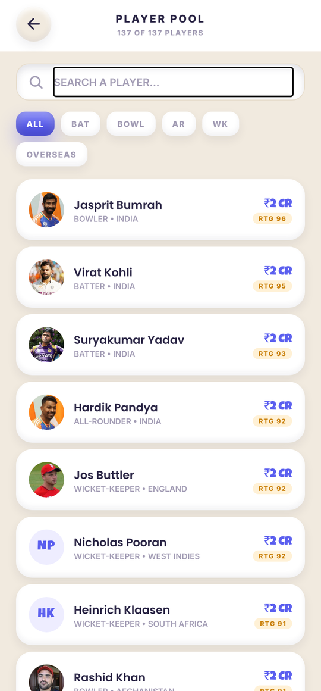

<p align="center">
  
</p>

<h1 align="center">SKELP!</h1>

<p align="center"><b>The IPL-style player auction you play with your friends — fully offline.</b></p>

<p align="center">
  <a href="https://github.com/shankumar7/skelp/raw/main/release/skelp.apk"></a>
</p>

<p align="center">
  
  
  
</p>

---

Every cricket fan has argued about who they would have bought at the IPL auction.
**Skelp!** lets a group of friends actually do it. Everyone gets the same purse, real players come
under the hammer one by one, the clock ticks, and the highest bid takes the player home.

No internet is needed. One phone **hosts** the arena, and everyone on the same Wi-Fi — or connected
to that phone's **mobile hotspot** — joins it directly, phone to phone.

<p align="center">
  
  
  
  
  
</p>

## Contents

- [Install](#install)
- [Features](#features)
- [How to play with friends](#how-to-play-with-friends-no-internet)
- [Auction rules](#auction-rules)
- [How it works](#how-it-works)
- [Privacy and security](#privacy-and-security)
- [Development](#development)
- [Credits](#credits)
- [License](#license)

## Install

1. On your Android phone, tap **[Download the APK](https://github.com/shankumar7/skelp/raw/main/release/skelp.apk)** — the file downloads straight away.
2. Open the downloaded file and allow *Install unknown apps* when Android asks.
3. Launch **Skelp!**, create a profile (or continue as a guest) and pick an avatar.

Works on Android 7.0 and newer, on both 64-bit and older 32-bit ARM phones.

## Features

| | |
| --- | --- |
| 📶 **Offline multiplayer** | One phone is the server; up to 10 teams join over Wi-Fi or hotspot. No internet, no account on any server. |
| 🔎 **Three ways to join** | Scan the host's **QR code**, tap *Find nearby arenas*, or type the arena code. |
| 📡 **Hotspot guide** | The app tells you when you are not on Wi-Fi and has one-tap shortcuts to the phone's hotspot and Wi-Fi settings. |
| 🏏 **Real auction rules** | Base prices, IPL-style bid increments, a bid clock that resets on every bid, purse, squad and overseas limits, a marquee set and an accelerated round for unsold players. |
| 👥 **137 players** | Role, country, base price and rating for each; 85 with a freely-licensed photo. |
| 🤖 **Bots** | Practise solo against AI bidders, or add bots to fill empty seats. |
| 🔊 **Sound and haptics** | Bid blips, a ticking last five seconds, the gavel on *Sold*, a buzz when you are outbid. One tap to mute. |
| 🔥 **Live room feel** | Emoji reactions that pop up on every phone, an *Up next* strip and a running *Sold* feed. |
| 🧭 **Scout the pool** | Browse and search every player by role before the auction. |
| 🏆 **Results worth sharing** | Final table, costliest buy, steal of the auction and one-tap sharing. |
| 🔁 **Drop-proof** | A phone that loses Wi-Fi or goes to the background reconnects on its own and keeps its team. |

## How to play with friends (no internet)

1. **Get everyone on one network.** Join the same Wi-Fi, or one person turns on their
   **mobile hotspot** and the others connect to it. Mobile data can stay off.
   The dashboard has **HOTSPOT** and **WI-FI** buttons that open the right settings page.
2. **Host:** tap **HOST YOUR OWN ARENA**. The lobby shows a **QR code** and an **arena code**.
3. **Everyone else:** tap **SCAN QR** and point the camera at the host's screen.
   Or tap **FIND NEARBY ARENAS** and pick the arena under *Live auctions*, or type the arena code in the search box.
4. The host picks a mode and the bid clock, optionally adds bots, and taps **START AUCTION**.
5. Bid, jump-bid or pass on each player. When the clock runs out the player is **SOLD** to the highest bidder.
6. When every player has been through, the final table ranks the squads.

> **Tip:** the host's phone runs the auction, so keep Skelp! open on it until the auction ends.
> The app keeps the screen awake for you.

## Auction rules

| Mode | Purse | Players in pool | Max squad | Max overseas |
| --- | --- | --- | --- | --- |
| Quick | ₹50 Cr | 40 | 8 | 3 |
| Classic | ₹90 Cr | 90 | 15 | 6 |
| Mega | ₹120 Cr | 137 | 25 | 8 |

- Bidding opens at the player's **base price** (₹30 L – ₹2 Cr).
- Each bid raises the price by **₹5 L** below ₹1 Cr, **₹10 L** up to ₹2 Cr, **₹20 L** up to ₹5 Cr and **₹25 L** above that. The two smaller buttons place a *jump bid*.
- Every bid resets the clock (10, 15 or 20 seconds). **PASS** takes you out of the current player; if everyone else passes, the hammer falls immediately.
- You cannot bid more than your purse, beyond your squad size, or for an overseas player once your overseas slots are full.
- Players nobody bids on go **unsold** and come back once in an accelerated round at the end.
- The winner is the team with the highest **squad power** — the total rating of its best eleven players.

## How it works

```
        Host phone                              Other phones
┌──────────────────────────┐   TCP :47474   ┌──────────────────────┐
│ auction engine (reducer) │◄──────────────►│ ClientSession        │
│ bid clock + bots         │  JSON lines    │ mirrors host state,  │
│ HostSession (TCP server) │                │ sends bid / pass     │
└──────────────────────────┘                └──────────────────────┘
```

- `game/engine.ts` is a pure reducer holding all the rules. The host applies every action and broadcasts the resulting state, so all phones always agree.
- On Android every connection is bound to the Wi-Fi network. A hotspot has no internet, so the phone would otherwise route the app over mobile data and never reach the host.
- `game/net/` is the LAN layer: newline-delimited JSON over a plain TCP socket ([react-native-tcp-socket](https://github.com/Rapsssito/react-native-tcp-socket)), heartbeats, automatic reconnect, and discovery by probing the hotspot gateway and then the rest of the local subnet.
- The countdown is animated locally on each phone between host updates, so the clock stays smooth without flooding the network.

## Privacy and security

- **Nothing leaves your network.** There is no backend, analytics or advertising. Profiles, stats and history are stored only on the phone.
- **The host is the referee.** Other phones can only bid or pass for their own team; every action is validated on the host, and nobody can act for another team or send host commands.
- **Untrusted input is bounded.** Names, avatars and ids from other phones are length-checked and sanitised, oversized messages drop the connection, reactions are rate-limited, and phones ignore malformed data from a host.
- **Minimal permissions:** network and Wi-Fi state (to find the host), vibration, and the camera — asked for only when you tap *Scan QR*, and used only to read the code. No location, storage, contacts or microphone.
- The local profile password only keeps casual hands out of your profile on your own phone; it is not sent anywhere. The link between phones is not encrypted, so play on a network you trust.

## Development

```bash
npm install
```

```bash
npx expo start
```

```bash
npm test
```

`npm test` runs the rules engine tests, complete bot-vs-bot auctions, and end-to-end LAN tests with a host and several clients talking over real TCP sockets. `npm run typecheck` and `npm run lint` are also available.

LAN play and sound need native code, so use a development build or the APK rather than Expo Go. The web build (`npx expo start --web`) supports solo practice only.

### Build the APK

Needs Node 20+, JDK 17, and the Android SDK (platform 36, build-tools 36.0.0, NDK 27.1.12297006) with `ANDROID_HOME` set.

```bash
npm run build:apk
```

The APK is written to `release/skelp.apk`. Release builds are code-shrunk (R8) and ship 64-bit and 32-bit ARM libraries. The APK is signed with the standard debug key, which is fine for sharing the file directly; publishing on Google Play needs your own signing key.

### Project layout

```
app/                  entry screens (expo-router): splash, welcome, sign in, avatar, about
components/skelp/     dashboard, lobby, live arena, results, player pool, shared clay UI kit
game/                 engine, bots, players, sound, local storage
game/net/             TCP transport, protocol, host & client sessions, discovery
assets/players/       bundled player photos
assets/sounds/        sound effects (generated by scripts/make-sounds.py)
scripts/              player data, sound and APK build scripts
__tests__/            engine and LAN tests
```

## Credits

- Built by **Pitta Shankumar** — [GitHub](https://github.com/shankumar7)
- Player photos are from [Wikimedia Commons](https://commons.wikimedia.org) and are used under their own free licences. Every photo's author and licence is listed in [CREDITS.md](CREDITS.md) and inside the app (*About → Player photos*).
- Sound effects are synthesised by a script in this repository; no third-party samples are used.
- Player ratings and base prices are game-design values, not official figures.

Skelp! is a fan-made game. It is not affiliated with or endorsed by the IPL, the BCCI or any franchise.

## License

The source code is released under the [MIT License](LICENSE).
Player photos in `assets/players/` are **not** covered by the MIT licence — each keeps the licence listed in [CREDITS.md](CREDITS.md).
